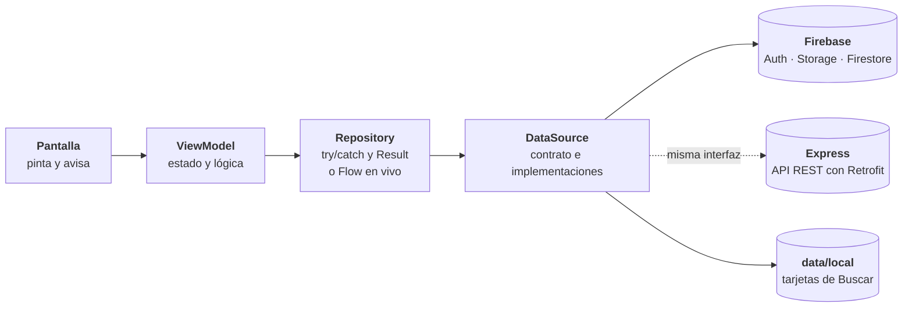

[← Documentación](README.md)

# Arquitectura

Las capas de la app, cómo se conectan y cómo están organizadas las carpetas.

Dos capas, UI y datos. La capa de dominio queda fuera.



**El data source** declara la petición y devuelve el DTO de su base. Cada contrato
(`AlbumRemoteDataSource`, `CancionRemoteDataSource`, `ArtistaRemoteDataSource`,
`ReviewRemoteDataSource`, `UsuarioRemoteDataSource`, `NotificacionRemoteDataSource`,
`HistoriaRemoteDataSource`, `DueloRemoteDataSource`, `SonandoRemoteDataSource` y
`MixtapeRemoteDataSource`) tiene una implementación en `impl/firestore` y otra en `impl/retrofit`.
La ubicación del celular tiene su contrato, `UbicacionDataSource`, con la implementación de Android
en `impl/android`. Si el documento no existe, el data
source retorna `null` y el repositorio decide el error. Los repositorios reciben el contrato y
`DataSourceModule` dice con `@Binds` qué implementación entrega Hilt. **El repositorio** hace el
`try`/`catch`, mapea el DTO al modelo de la pantalla, organiza varios data sources (por ejemplo,
`CatalogoRepository` junta los álbumes, las canciones, los artistas y sus reseñas, y la reseña lleva
una copia del usuario y del item) y devuelve un `Result<T>`. El mapeo deja los números y las fechas
listos para la pantalla: 14 929 likes se ven como `14K` y la fecha como `3 h`. Para los datos en vivo
devuelve un `Flow` y los errores llegan al `catch` del ViewModel. **El ViewModel** mira
`result.isSuccess` (o recolecta el flujo con `collect`), toma uno de los dos caminos y ahí vive la
lógica: filtrar, ordenar y decidir qué se muestra. **La pantalla** pinta y avisa.

| Qué | Con qué |
|---|---|
| UI | Jetpack Compose · Material 3 · Coil · Google Fonts |
| Estado | ViewModel · `MutableStateFlow` · un `UiState` por pantalla |
| Navegación | Navigation Compose · un `NavHost` · rutas en `sealed class` |
| Datos | Firebase Auth · Storage · Cloud Firestore · Cloud Messaging · Retrofit · corrutinas con `suspend`, `viewModelScope` y `Flow` |
| Inyección | Dagger Hilt con KSP: `FirebaseHiltModule`, `AppModule`, `DataSourceModule`, `UbicacionModule` y `CoroutineModule` |
| Build | Gradle Kotlin DSL · `libs.versions.toml` · `BuildConfig` para el modo debug |
| Pruebas | JUnit · Truth · MockK · `runTest` y `StandardTestDispatcher` · Compose UI Test · Hilt testing · emulador de Firebase |

## Estructura de carpetas

```text
app/src/main/java/com/example/mixtapp/
├── data/
│   ├── datasource/      contratos · Auth · Storage · Messaging · Busqueda (local) · Ubicacion
│   │   ├── impl/
│   │   │   ├── android/     UbicacionAndroidDataSourceImpl (LocationManager)
│   │   │   ├── firestore/   Album · Cancion · Artista · Review · Usuario · Notificacion · Historia · Duelo · Sonando · Mixtape · MisLikes
│   │   │   └── retrofit/    Album · Cancion · Artista · Review · Usuario · Notificacion · Historia · Duelo · Sonando · Mixtape
│   │   └── services/    servicios de Retrofit · MyFirebaseMessagingService
│   ├── dtos/            DTO de cada base, sus funciones de mapeo y Formatos (14K, 3 h, links)
│   ├── injection/       FirebaseHiltModule · AppModule · DataSourceModule · CoroutineModule · UbicacionModule
│   ├── local/           las tarjetas de Buscar y los datos de los previews
│   ├── model/           las entidades que usa la UI y las reglas (Reglas*.kt, LoQueMeGusta)
│   └── repository/      los repositorios y AppExceptions
├── ui/
│   ├── navigation/      AppNavigation (NavHost) · NavigationLogic · Screen · BottomNav · BottomNavItem
│   ├── screens/<x>/     XScreen · XState · XViewModel · components/ · model/
│   ├── theme/           Color · Theme · Type
│   └── utils/           los componentes que comparten dos o más pantallas
├── BaseApplication.kt   @HiltAndroidApp · en debug conecta Firebase al emulador
├── MainActivity.kt      @AndroidEntryPoint
└── Mixtapp.kt           permiso de notificaciones + Scaffold + barra + botón flotante + AppNavigation

app/src/test/java/com/example/mixtapp/
├── dtos/                mapeos y formatos
├── local/               datos fijos de la app
├── model/               las reglas de data/model
├── repository/          los repositorios con mocks (MockK)
└── viewmodels/          los ViewModels con mocks y el dispatcher de prueba

app/src/androidTest/java/com/example/mixtapp/
├── datasource/          pruebas de integración de los data sources de Firestore
├── repository/          pruebas de integración de los repositorios
├── viewmodels/          prueba de integración del ViewModel de registro
├── e2e/                 los casos de uso del sprint 13 de punta a punta
├── DatosDePrueba.kt     los datos que crea cada prueba y la limpieza de la base
└── HiltTestRunner.kt    arranca las pruebas con la aplicación de prueba de Hilt
```

Los diagramas de clases y de entidad-relación están en `Docs/`.


Proyecto de **Computación Móvil**, Pontificia Universidad Javeriana, sede Bogotá.
Profesor: Juan Sebastián Angarita Torres.


Ramas cortas desde `master` actualizado, una por bloque de trabajo, y un pull request por rama.
Los mensajes de commit van en español, sin tildes, con prefijo `feat:`, `fix:`, `refactor:`,
`style:`, `chore:` o `docs:`.
