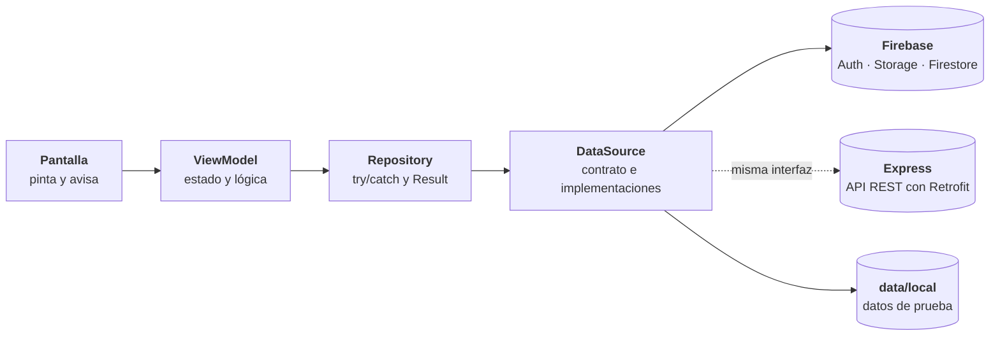

<p align="center">
  
</p>

<h1 align="center">Mixtapp</h1>

<p align="center"><b>Califica, reseña y descubre álbumes con la gente a la que sigues.</b></p>

<p align="center">
  
  
  
  
  
  
  
  
</p>

Mixtapp es una app Android donde abres un álbum, le pones de 0 a 5 estrellas, escribes tu reseña
y ves lo que publican las demás personas. Está escrita en Kotlin con Jetpack Compose, una sola
Activity y arquitectura en capas sobre Firebase (Authentication, Storage y Cloud Firestore). Es el
proyecto semestral de Computación Móvil de la Pontificia Universidad Javeriana.

> [!NOTE]
> Los álbumes, las reseñas y los perfiles viven en **Cloud Firestore**. La capa de datos tiene una
> segunda implementación con **Retrofit** contra el backend de Express
> ([mixtapp-backend](https://github.com/AndresContreras1/mixtapp-backend)): las dos cumplen el mismo
> contrato y se cambia de una a otra con una línea en cada repositorio. Seguidos, notificaciones y
> la discusión de una reseña siguen con datos de prueba en `data/local/`.

[Estado](#estado) · [Arquitectura](#arquitectura) · [Datos en Firestore](#datos-en-firestore) ·
[Decisiones](#decisiones) · [Cómo ejecutarlo](#cómo-ejecutarlo) · [Estructura](#estructura)

## Estado

| Módulo | Estado |
|---|---|
| Registro, inicio de sesión y sesión persistente con Firebase Auth | Funcionando |
| Al registrarse, el nombre y el usuario quedan guardados en Firestore | Funcionando |
| Mi perfil y modificarlo (nombre, usuario y biografía) | Funcionando, Firestore |
| Perfil de cualquier otro usuario con sus reseñas | Funcionando, Firestore |
| Inicio con todos los álbumes, la tendencia y la actividad de otros usuarios | Funcionando, Firestore |
| Detalle del álbum con promedio, total de calificaciones y % que lo recomienda | Funcionando, Firestore |
| Escribir, modificar y eliminar mi reseña desde el álbum, mi perfil y Mis reseñas | Funcionando, Firestore |
| Foto de perfil subida a Firebase Storage | Funcionando |
| Consumo del backend de Express con Retrofit | Implementado, intercambiable con Firestore |
| Seguidos, notificaciones y discusión de una reseña | Datos de prueba en memoria |
| Modo claro | Pendiente: falta diseñar cómo se ven las pantallas en claro |
| Tipografía propia del tema | Pendiente |

## Arquitectura

Dos capas, UI y datos. La capa de dominio queda fuera.



**El data source** declara la petición y devuelve el DTO de su base. Cada contrato
(`AlbumRemoteDataSource`, `ReviewRemoteDataSource`, `UsuarioRemoteDataSource`) tiene una
implementación en `impl/firestore` y otra en `impl/retrofit`. **El repositorio** hace el
`try`/`catch`, mapea el DTO al modelo de la pantalla, organiza varios data sources (por ejemplo, la
reseña lleva una copia del usuario y del álbum) y devuelve un `Result<T>`. **El ViewModel** mira
`result.isSuccess`, toma uno de los dos caminos y ahí vive la lógica: filtrar, ordenar y decidir
qué se muestra. **La pantalla** pinta y avisa.

| Qué | Con qué |
|---|---|
| UI | Jetpack Compose · Material 3 · Coil |
| Estado | ViewModel · `MutableStateFlow` · un `UiState` por pantalla |
| Navegación | Navigation Compose · un `NavHost` · rutas en `sealed class` |
| Datos | Firebase Auth · Storage · Cloud Firestore · Retrofit · corrutinas con `suspend` y `viewModelScope` |
| Inyección | Dagger Hilt con KSP: `FirebaseHiltModule` y `AppModule` |
| Build | Gradle Kotlin DSL · `libs.versions.toml` |

## Datos en Firestore

| Colección | Documento | Campos |
|---|---|---|
| `usuarios` | el uid de Authentication | `username`, `nombre`, `bio`, `fotoUrl` |
| `albumes` | `1` a `8` | `titulo`, `artista`, `portadaUrl`, `anio`, `genero` |
| `reviews` | id aleatorio | `usuarioId`, `albumId`, `calificacion`, `comentario`, `fechaEscucha`, `usuario`, `album` |

- El correo y la contraseña se quedan en Authentication; en Firestore no se guardan.
- Firestore no tiene joins, así que cada reseña guarda una copia de lo que se muestra con ella:
  `usuario` (`nombre`, `fotoUrl`) y `album` (`titulo`, `artista`, `portadaUrl`).
- Si alguien cambia su nombre, sus reseñas viejas conservan el anterior. Es el costo de
  desnormalizar y se acepta.

## Decisiones

- **La navegación no entra al ViewModel.** Las pantallas reciben lambdas `onXClick` y las resuelve
  `AppNavigation.kt`. La única excepción es `BottomNav`, que existe solo para navegar.
- **A las pantallas de detalle les llega el id, no el objeto.** El ViewModel busca la entidad y la
  pantalla decide qué pintar si no existe.
- **Un solo `Scaffold`**, en `Mixtapp.kt`, con la barra inferior y el botón flotante en sus ranuras.
  `NavigationLogic` decide en qué rutas se ven. El botón **+** abre la lista de álbumes para elegir
  cuál reseñar.
- **Una sola calificación por álbum.** La pantalla de escribir carga mi reseña de ese álbum si ya
  existe: si llega su id se modifica y si no se crea.
- **Mis reseñas se editan en el mismo perfil.** El lápiz convierte la tarjeta en un formulario y la
  papelera la elimina sin salir de la pantalla.
- **El promedio y el porcentaje que recomienda se calculan en el repositorio** con las reseñas
  guardadas de cada álbum; las de todos los álbumes se piden a la vez con `async`.
- **Mi reseña la marca el repositorio.** Cada reseña llega con `esMia` (su `usuarioId` es mi uid),
  así el inicio, el detalle y la pantalla de escribir saben cuál es la mía sin otra petición.
- **Inicio, Buscar, perfil, Mis reseñas y el detalle se vuelven a pedir al mostrarse**, así una
  reseña nueva aparece al volver.
- **El color sale del `MaterialTheme`.** No hay colores quemados fuera de `Color.kt`.
- **La app es solo oscura.** El esquema claro existe como plantilla, pero no se aplica hasta que
  estén diseñadas las pantallas en modo claro.
- **Hay callbacks vacíos a propósito**: más opciones y las pestañas Diario, Listas y Biblioteca del
  perfil apuntan a pantallas que todavía no existen.

## Cómo ejecutarlo

Necesitas Android Studio con JDK 21 (el que pide `gradle/gradle-daemon-jvm.properties`) y un
emulador o dispositivo con **Android 8.0 o superior** (`minSdk 26`). El `google-services.json` ya viene en `app/`.

```bash
git clone https://github.com/AndresContreras1/Mixtapp.git
```

Abre la carpeta en Android Studio, espera a que Gradle sincronice y dale a **Run**. Desde la
terminal, `./gradlew assembleDebug` (en Windows `gradlew.bat assembleDebug`).

<details>
<summary>Firestore: crear la base y los datos iniciales</summary>

1. Consola de Firebase → **Firestore Database → Crear base de datos**, en **modo de prueba**.
2. Cargar los datos iniciales: los 8 álbumes en `albumes` (ids `1` a `8`), cuatro usuarios de
   prueba en `usuarios` y sus reseñas en `reviews`, con los campos de la tabla de arriba.
3. Crear una cuenta en la app: el registro guarda tus datos en `usuarios` con tu uid.

</details>

<details>
<summary>Usar el backend de Express en vez de Firestore</summary>

En `AlbumRepository`, `ReviewRepository` y `UsuarioRepository` cambia la implementación que
reciben (`...FirestoreDataSourceImpl`) por la de Retrofit (`...RetrofitDataSourceImpl`) y corre
`npm run dev` en `mixtapp-backend`. El emulador lo encuentra en `http://10.0.2.2:3000/`. Los usuarios
de Firebase no existen en el backend, así que la implementación de Retrofit trata al usuario `1` como
el usuario de la app: guarda mis reseñas a su nombre y, al leerlas, las devuelve con mi uid.

</details>

<details>
<summary>Dos ajustes en la consola de Firebase</summary>

Sin ellos, dos de los mensajes de error nunca salen:

1. **Authentication → Settings → Protección contra enumeración de correos: desactivada.** Mientras
   esté activa, Firebase no distingue "no existe la cuenta" de "contraseña incorrecta".
2. **Authentication → Settings → Política de contraseñas → Exigir aplicación**, con mayúscula y
   número. En modo *Notificar* el registro se acepta igual.

</details>

## Estructura

```text
app/src/main/java/com/example/mixtapp/
├── data/
│   ├── datasource/      contratos · Auth · Storage · locales
│   │   ├── impl/
│   │   │   ├── firestore/   Album · Review · Usuario
│   │   │   └── retrofit/    Album · Review · Usuario
│   │   └── services/    servicios de Retrofit
│   ├── dtos/            DTO de cada base y sus funciones de mapeo
│   ├── injection/       FirebaseHiltModule · AppModule
│   ├── local/           proveedores de datos de prueba
│   ├── model/           las entidades que usa la UI
│   └── repository/      los repositorios y AppExceptions
├── ui/
│   ├── navigation/      AppNavigation (NavHost) · NavigationLogic · Screen · BottomNav
│   ├── screens/<x>/     XScreen · XState · XViewModel · components/ · model/
│   ├── theme/           Color · Theme · Type
│   └── utils/           los componentes que comparten dos o más pantallas
├── MainActivity.kt      @AndroidEntryPoint
└── Mixtapp.kt           Scaffold + barra + botón flotante + AppNavigation
```

Los diagramas de clases y de entidad-relación están en `Docs/`.


Proyecto de **Computación Móvil**, Pontificia Universidad Javeriana, sede Bogotá.
Profesor: Juan Sebastián Angarita Torres.


Ramas cortas desde `master` actualizado, una por bloque de trabajo, y un pull request por rama.
Los mensajes de commit van en español, sin tildes, con prefijo `feat:`, `fix:`, `refactor:`,
`style:`, `chore:` o `docs:`.
