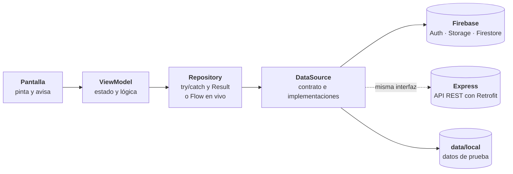

<p align="center">
  
</p>

<h1 align="center">Mixtapp</h1>

<p align="center"><b>Califica, reseña y descubre álbumes con la gente a la que sigues.</b></p>

<p align="center">
  
  
  
  
  
  
  
  
</p>

Mixtapp es una app Android donde abres un álbum, le pones de 0 a 5 estrellas, escribes tu reseña
y ves lo que publican las demás personas. Puedes dar like a las reseñas, seguir a otros usuarios y
recibir una notificación cuando alguien le da like a la tuya. Está escrita en Kotlin con Jetpack
Compose, una sola Activity y arquitectura en capas sobre Firebase (Authentication, Storage, Cloud
Firestore y Cloud Messaging). Es el proyecto semestral de Computación Móvil de la Pontificia
Universidad Javeriana.

> [!NOTE]
> Los álbumes, las reseñas, los perfiles, los likes y los seguidores viven en **Cloud Firestore**.
> La capa de datos tiene una segunda implementación con **Retrofit** contra el backend de Express
> ([mixtapp-backend](https://github.com/AndresContreras1/mixtapp-backend)): las dos cumplen el mismo
> contrato y se cambia de una a otra con una línea por contrato en `DataSourceModule`. Las funciones en línea
> (integridad de los datos y notificaciones) están en su propio proyecto,
> [mixtapp-functions](https://github.com/AndresContreras1/mixtapp-functions).

[Estado](#estado) · [Arquitectura](#arquitectura) · [Datos en Firestore](#datos-en-firestore) ·
[Notificaciones](#notificaciones) · [Decisiones](#decisiones) · [Cómo ejecutarlo](#cómo-ejecutarlo) ·
[Estructura](#estructura)

## Estado

| Módulo | Estado |
|---|---|
| Registro, inicio de sesión y sesión persistente con Firebase Auth | Funcionando |
| Al registrarse, el nombre, el usuario y el token de notificaciones quedan guardados en Firestore | Funcionando |
| Mi perfil y modificarlo (nombre, usuario y biografía) | Funcionando, Firestore |
| Perfil de cualquier otro usuario con sus reseñas | Funcionando, Firestore |
| Inicio con todos los álbumes, la tendencia y la actividad de quienes sigo, **en tiempo real** | Funcionando, Firestore |
| Filtro **Seguidos** del inicio y pestaña Siguiendo: solo las reseñas de los usuarios que sigo | Funcionando, Firestore |
| Detalle del álbum con promedio, total de calificaciones y % que lo recomienda | Funcionando, Firestore |
| Escribir, modificar y eliminar mi reseña desde el álbum, mi perfil y Mis reseñas | Funcionando, Firestore |
| Dar y quitar like a una reseña, con el total de likes | Funcionando, Firestore |
| Seguir y dejar de seguir, con el total de seguidores y seguidos | Funcionando, Firestore |
| Lista de seguidores y de seguidos de cualquier perfil | Funcionando, Firestore |
| Notificación cuando alguien le da like a mi reseña, la comenta, responde mi comentario o me empieza a seguir | Funcionando, FCM y Cloud Functions |
| Foto de perfil subida a Firebase Storage | Funcionando |
| Consumo del backend de Express con Retrofit | Implementado, intercambiable con Firestore |
| Discusión de una reseña: comentarios, respuestas y likes a cada comentario, **en tiempo real** | Funcionando, Firestore |
| Modo debug contra el emulador de Firebase (Firebase CLI) | Funcionando |
| Datos falsos con Faker para el emulador o el Firebase real | Script en [mixtapp-functions](https://github.com/AndresContreras1/mixtapp-functions) |
| Pruebas de integración de los data sources y los repositorios contra el emulador | 16 + 15 pruebas |
| Pantalla de notificaciones | Datos de prueba en `data/local/` |
| Modo claro | Pendiente: falta diseñar cómo se ven las pantallas en claro |

## Arquitectura

Dos capas, UI y datos. La capa de dominio queda fuera.



**El data source** declara la petición y devuelve el DTO de su base. Cada contrato
(`AlbumRemoteDataSource`, `ReviewRemoteDataSource`, `UsuarioRemoteDataSource`) tiene una
implementación en `impl/firestore` y otra en `impl/retrofit`. Si el documento no existe, el data
source retorna `null` y el repositorio decide el error. Los repositorios reciben el contrato y
`DataSourceModule` dice con `@Binds` qué implementación entrega Hilt. **El repositorio** hace el
`try`/`catch`, mapea el DTO al modelo de la pantalla, organiza varios data sources (por ejemplo, la
reseña lleva una copia del usuario y del álbum) y devuelve un `Result<T>`. Para los datos en vivo
devuelve un `Flow` y los errores llegan al `catch` del ViewModel. **El ViewModel** mira
`result.isSuccess` (o recolecta el flujo con `collect`), toma uno de los dos caminos y ahí vive la
lógica: filtrar, ordenar y decidir qué se muestra. **La pantalla** pinta y avisa.

| Qué | Con qué |
|---|---|
| UI | Jetpack Compose · Material 3 · Coil · Google Fonts |
| Estado | ViewModel · `MutableStateFlow` · un `UiState` por pantalla |
| Navegación | Navigation Compose · un `NavHost` · rutas en `sealed class` |
| Datos | Firebase Auth · Storage · Cloud Firestore · Cloud Messaging · Retrofit · corrutinas con `suspend`, `viewModelScope` y `Flow` |
| Inyección | Dagger Hilt con KSP: `FirebaseHiltModule`, `AppModule` y `DataSourceModule` |
| Build | Gradle Kotlin DSL · `libs.versions.toml` · `BuildConfig` para el modo debug |
| Pruebas | JUnit · Truth · `runTest` · emulador de Firebase |

## Datos en Firestore

| Colección | Documento | Campos |
|---|---|---|
| `usuarios` | el uid de Authentication | `username`, `nombre` (texto) · `bio`, `fotoUrl` (texto o null) · `followersCount`, `followingCount` (número) · `fcmtoken` (texto) |
| `usuarios/<uid>/followers` | el uid de quien me sigue | `timestamp` |
| `usuarios/<uid>/following` | el uid de quien sigo | `timestamp` |
| `albumes` | `1` a `8` | `titulo`, `artista`, `portadaUrl`, `genero` (texto) · `anio` (número) |
| `reviews` | id aleatorio | `usuarioId`, `albumId` (texto) · `calificacion` (número) · `comentario` (texto) · `fechaEscucha` (texto `AAAA-MM-DD` o null) · `likesCount`, `commentsCount` (número) · `usuario` y `album` (mapas) |
| `reviews/<id>/likes` | el uid de quien dio like | `timestamp` |
| `reviews/<id>/comments` | id aleatorio | `usuarioId`, `contenido` (texto) · `parentCommentId` (texto o null) · `likesCount` (número) · `createdAt` (texto ISO) · `usuario` (mapa) |
| `reviews/<id>/comments/<id>/likes` | el uid de quien dio like | `timestamp` |

Los tipos tienen que coincidir con los DTO: `toObject` falla si `anio` o `calificacion` no son
número, y `whereEqualTo` no encuentra reseñas si `albumId` o `usuarioId` se guardan como número.

- El correo y la contraseña se quedan en Authentication; en Firestore no se guardan.
- Firestore no tiene joins, así que cada reseña guarda una copia de lo que se muestra con ella:
  `usuario` (`nombre`, `fotoUrl`) y `album` (`titulo`, `artista`, `portadaUrl`).
- Si alguien cambia su nombre o su foto, la Cloud Function `updateUserInfoInReviews` actualiza esa
  copia en todas sus reseñas. Así las copias no quedan viejas.

### Likes y seguidores

Los likes y los seguidores son relaciones muchos a muchos, así que van en **subcolecciones** y no
como listas de ids dentro del documento: una lista crecería sin límite y cada consulta traería ids
que la tarjeta no usa. La tarjeta solo necesita el número, que vive en el documento principal
(`likesCount`, `followersCount`, `followingCount`).

- **Dar o quitar like** es una sola función: dentro de una **transacción** lee
  `reviews/<id>/likes/<mi uid>`. Si existe, lo borra y resta 1 a `likesCount`; si no, lo crea con
  `FieldValue.serverTimestamp()` y suma 1. Si una de las dos escrituras falla, Firebase deshace la
  otra.
- **Seguir** son cuatro escrituras en la misma transacción: `following/<B>` en A,
  `followers/<A>` en B, `followingCount` de A y `followersCount` de B.
- **Si ya di like o ya lo sigo** sale de buscar mi uid en la subcolección con `exists()`. El data
  source recibe `currentUserId` como parámetro opcional, para que Retrofit no lo tenga que usar.
- **La UI** invierte el corazón o el botón y sube o baja el contador solo si la transacción sale
  bien, sin volver a leer la base.
- **La lista de seguidores o de seguidos** es una segunda consulta a la subcolección. Se abre al
  tocar el contador en cualquier perfil.

### Comentarios de la discusión

Cada reseña tiene su discusión. Los comentarios van en la subcolección `reviews/<id>/comments` y
la reseña guarda el total en `commentsCount`, igual que los likes.

- **Comentar** es una transacción: crea el comentario y suma 1 a `commentsCount`. El comentario
  guarda una copia de mi nombre y mi foto, como la reseña.
- **Responder** guarda el id del comentario principal en `parentCommentId`. El repositorio arma el
  hilo: cada comentario principal va seguido de sus respuestas.
- **Dar like a un comentario** es la misma transacción que el like de la reseña, en
  `comments/<id>/likes/<mi uid>` con su `likesCount`.
- **En tiempo real:** la discusión escucha la reseña y sus comentarios con dos `callbackFlow`, y
  `combine` la arma cada vez que llega cualquiera de los dos. Es como un chat: un comentario desde
  otro celular aparece sin recargar.
- **Borrar la reseña** borra a mano sus likes y sus comentarios (con los likes de cada uno), porque
  Firestore no borra las subcolecciones.

Para comprobarlo con dos cuentas:

1. Dar like a una reseña: en la consola aparece `reviews/<id>/likes/<uid>` y `likesCount` sube.
   Quitarlo borra el documento y el contador baja.
2. Seguir un perfil: aparecen `following` en mi usuario y `followers` en el otro, con los dos
   contadores. Tocar el contador abre la lista.
3. Con el filtro **Seguidos** del inicio, escribir una reseña desde la otra cuenta: aparece sola,
   sin recargar.
4. Abrir la misma discusión en los dos celulares y comentar desde uno: el comentario y el total
   aparecen en el otro. Responder un comentario lo deja debajo del que responde.

## Notificaciones

La app usa **Firebase Cloud Messaging**. `MyFirebaseMessagingService` está en
`data/datasource/services` y declarado en el manifiesto con el permiso `POST_NOTIFICATIONS`. En
Android 13 o superior, `Mixtapp.kt` pide el permiso al abrir la app (solo si todavía no está
concedido). El token del celular se guarda en `usuarios/<uid>.fcmtoken` al registrarse y al iniciar
sesión.

Las notificaciones las envían tres Cloud Functions de
[mixtapp-functions](https://github.com/AndresContreras1/mixtapp-functions):
`sendLikeNotification` («Nuevo me gusta»), `sendFollowNotification` («Nuevo seguidor») y
`sendCommentNotification` («Nuevo comentario» al autor de la reseña y «Nueva respuesta» al autor
del comentario que se responde). Para que llegue en las pruebas, la app debe estar en segundo plano
o cerrada.

## Decisiones

- **La navegación no entra al ViewModel.** Las pantallas reciben lambdas `onXClick` y las resuelve
  `AppNavigation.kt`. La única excepción es `BottomNav`, que existe solo para navegar.
- **A las pantallas de detalle les llega el id, no el objeto.** El ViewModel busca la entidad y la
  pantalla decide qué pintar si no existe.
- **Un solo `Scaffold`**, en `Mixtapp.kt`, con la barra inferior y el botón flotante en sus ranuras.
  `NavigationLogic` decide en qué rutas se ven. El botón **+** abre la lista de álbumes para elegir
  cuál reseñar.
- **Una sola calificación por álbum.** La pantalla de escribir carga mi reseña de ese álbum si ya
  existe: si llega su id se modifica y si no se crea.
- **Mis reseñas se editan en el mismo perfil.** El lápiz convierte la tarjeta en un formulario y la
  papelera la elimina sin salir de la pantalla.
- **El promedio y el porcentaje que recomienda se calculan en el repositorio** con las reseñas
  guardadas de cada álbum; las de todos los álbumes se piden a la vez con `async`.
- **Mi reseña la marca el repositorio.** Cada reseña llega con `esMia` (su `usuarioId` es mi uid),
  así el inicio, el detalle y la pantalla de escribir saben cuál es la mía sin otra petición.
- **Solo el inicio está en tiempo real.** Escucha la colección `reviews` con `callbackFlow` y
  `addSnapshotListener`, y el ViewModel empieza a escuchar una sola vez en su `init`. Cada cambio en
  Firestore es una lectura que se cobra, así que Buscar, el perfil, Mis reseñas y el detalle se
  vuelven a pedir al mostrarse, como antes.
- **El color sale del `MaterialTheme`.** No hay colores quemados fuera de `Color.kt`, salvo el
  fondo de la ventana en `themes.xml` y los drawables XML (icono y marcadores de imagen), que se
  pintan sin Compose y repiten a mano los colores de la paleta.
- **Tipografía de Google Fonts:** Playfair Display para los títulos e Inter para el texto. El
  certificado está en `res/values/font_certs.xml`. Sin internet, Android usa la fuente por defecto.
- **Hilt se compila con KSP.** El proyecto está en AGP 9.0.0, que trae Kotlin integrado (por eso no
  se aplica `kotlin.android`) y deja `kapt` solo como transición. El plugin de KSP ya estaba en el
  build de clase. `firebase-storage` reemplaza a `firebase-storage-ktx`: desde el BoM 32.5 son el
  mismo módulo.
- **Los errores de Firestore los traduce el repositorio**, igual que el `HttpException` del
  backend: sin conexión, documento que no existe o error del servidor.
- **La app es solo oscura.** El esquema claro existe como plantilla, pero no se aplica hasta que
  estén diseñadas las pantallas en modo claro.
- **Hay callbacks vacíos a propósito**: más opciones y las pestañas Diario, Listas y Biblioteca del
  perfil apuntan a pantallas que todavía no existen.

## Cómo ejecutarlo

Necesitas Android Studio con JDK 21 (el que pide `gradle/gradle-daemon-jvm.properties`) y un
emulador o dispositivo con **Android 8.0 o superior** (`minSdk 26`). El `google-services.json` ya viene en `app/`.

```bash
git clone https://github.com/AndresContreras1/Mixtapp.git
```

Abre la carpeta en Android Studio y espera a que Gradle sincronice. **Debug** usa el emulador de
Firebase (ver abajo); **Play** con la variante *release* usa el Firebase real. Desde la terminal,
`./gradlew assembleDebug` (en Windows `gradlew.bat assembleDebug`).

<details>
<summary>Modo debug: el emulador de Firebase (Firebase CLI)</summary>

En debug, `BaseApplication` conecta Firestore y Authentication al emulador que corre en el
computador (`10.0.2.2` desde el emulador de Android): `if (BuildConfig.DEBUG)` con
`useEmulator("10.0.2.2", 8080)` y `useEmulator("10.0.2.2", 9099)`. Para eso el `build.gradle.kts`
tiene el tipo `debug` y `buildConfig = true`.

Hace falta Node.js. Desde [mixtapp-functions](https://github.com/AndresContreras1/mixtapp-functions),
que tiene los puertos en su `firebase.json`:

```bash
npm install -g firebase-tools
firebase emulators:start --only firestore,auth --project mixtapp-720eb
```

La interfaz queda en `http://127.0.0.1:4000/`, con las pestañas Authentication y Firestore. Los
datos se borran al cerrar la CLI: hay que registrarse otra vez o cargar los datos con Faker.

</details>

<details>
<summary>Datos falsos con Faker</summary>

El script está en la carpeta `seed/` de
[mixtapp-functions](https://github.com/AndresContreras1/mixtapp-functions). Crea usuarios, álbumes,
reseñas y comentarios con los mismos campos de la tabla de arriba, y sube al emulador o al
Firebase real cambiando dos líneas. Las instrucciones están en ese README. Estos datos son para ver
la app llena, no para las pruebas.

</details>

<details>
<summary>Pruebas de integración</summary>

Están en `app/src/androidTest`, contra el emulador de Firebase: necesitan el emulador de Android
prendido y la Firebase CLI corriendo (`firebase emulators:start --only firestore,auth`).

| Clase | Pruebas | Qué revisa |
|---|---|---|
| `datasource/UsuarioFirestoreDataSourceTest` | 8 | leer por id (válido y que no existe → `null`), registrar, seguir, el contador de seguidores, dejar de seguir, la lista de seguidores y las reseñas de un usuario |
| `datasource/ReviewFirestoreDataSourceTest` | 8 | leer por id, like y su contador, comentar y `commentsCount`, el orden de los comentarios, like a un comentario y borrar la reseña con sus comentarios |
| `repository/ReviewRepositoryIntegrationTest` | 8 | guardar la reseña (`Result` bien y álbum que no existe), la copia del nombre, sin sesión, comentar, el hilo de respuestas y la discusión que no existe |
| `repository/UsuarioRepositoryIntegrationTest` | 7 | mi perfil (con documento, sin documento, sin sesión), registrar, seguirme a mí mismo, seguir a otro y modificar el perfil |

Cada clase tiene `@Before` (conecta al emulador dentro de un `try`, limpia y carga sus propios
datos con `DatosDePrueba.kt`) y `@After` (borra las colecciones con sus subcolecciones; en los
repositorios también borra la cuenta de Authentication y cierra la sesión). Se corren con clic
derecho en la carpeta `androidTest` → **Run 'Tests in…'**.

</details>

<details>
<summary>Firestore: crear la base y los datos iniciales</summary>

1. Consola de Firebase → **Firestore Database → Crear base de datos**, en **modo de prueba**.
2. Cargar los datos iniciales con **Iniciar colección** y **Agregar documento**, con los ids y
   los tipos de la tabla de arriba:
   - `albumes`: los 8 álbumes de `data/local/LocalAlbumProvider.kt`, con las portadas de
     `data/local/AlbumCovers.kt` (ids `1` a `8`).
   - `usuarios`: cuatro usuarios de prueba (ids `2` a `5`) con `username`, `nombre` y `bio`.
   - `reviews`: sus reseñas, cada una con `usuarioId`, `albumId`, `likesCount` en 0 y las copias
     `usuario` (`nombre`, `fotoUrl`) y `album` (`titulo`, `artista`, `portadaUrl`).
3. Crear una cuenta en la app: el registro guarda tus datos en `usuarios` con tu uid.

Las reglas del modo de prueba vencen unos 30 días después de crear la base, igual que las de
Storage. Antes de la sustentación hay que reemplazarlas por las reglas de seguridad que están en
el README de [mixtapp-functions](https://github.com/AndresContreras1/mixtapp-functions)
(**Firestore Database → Reglas**) y revisar las de **Storage → Reglas**.

</details>

<details>
<summary>Cloud Functions y notificaciones</summary>

Las funciones se publican desde [mixtapp-functions](https://github.com/AndresContreras1/mixtapp-functions)
con `firebase deploy --only functions` (necesitan el plan Blaze). Para probar las notificaciones,
inicia sesión en dos celulares o emuladores con cuentas distintas, acepta el permiso de
notificaciones, deja uno en segundo plano y dale like desde el otro a una de sus reseñas.

El token de cada celular sale en el Logcat con el filtro `Token`. Con él se puede enviar una
notificación de prueba desde **Messaging → Enviar mensaje de prueba**.

</details>

<details>
<summary>Usar el backend de Express en vez de Firestore</summary>

En `data/injection/DataSourceModule.kt` cambia la implementación de cada `@Binds`
(`...FirestoreDataSourceImpl`) por la de Retrofit (`...RetrofitDataSourceImpl`) y corre
`npm run dev` en `mixtapp-backend`. Los repositorios no cambian: reciben el contrato. El emulador lo
encuentra en `http://10.0.2.2:3000/`.

- Los usuarios de Firebase no existen en el backend, así que la implementación de Retrofit trata
  al usuario `1` como el usuario de la app: guarda mis reseñas a su nombre y las devuelve con mi uid
  para que el repositorio sepa que son mías.
- El backend no tiene rutas para crear ni modificar usuarios, ni likes, seguidores o comentarios.
  Igual que en clase, esas funciones quedan como *to-do* en las implementaciones de Retrofit y las
  listas salen vacías: los likes, el seguimiento y los comentarios solo funcionan con Firestore.
- Con HTTP no hay una conexión continua: el flujo del inicio manda una sola vez lo que responde
  `GET /reviews`. La discusión de una reseña usa `GET /reviews/:id`, que trae el usuario y el álbum
  con `include` en la misma consulta.

</details>

<details>
<summary>Dos ajustes en la consola de Firebase</summary>

Sin ellos, dos de los mensajes de error nunca salen:

1. **Authentication → Settings → Protección contra enumeración de correos: desactivada.** Mientras
   esté activa, Firebase no distingue "no existe la cuenta" de "contraseña incorrecta".
2. **Authentication → Settings → Política de contraseñas → Exigir aplicación**, con mayúscula y
   número. En modo *Notificar* el registro se acepta igual.

</details>

## Estructura

```text
app/src/main/java/com/example/mixtapp/
├── data/
│   ├── datasource/      contratos · Auth · Storage · locales
│   │   ├── impl/
│   │   │   ├── firestore/   Album · Review · Usuario
│   │   │   └── retrofit/    Album · Review · Usuario
│   │   └── services/    servicios de Retrofit · MyFirebaseMessagingService
│   ├── dtos/            DTO de cada base y sus funciones de mapeo
│   ├── injection/       FirebaseHiltModule · AppModule · DataSourceModule
│   ├── local/           proveedores de datos de prueba
│   ├── model/           las entidades que usa la UI
│   └── repository/      los repositorios y AppExceptions
├── ui/
│   ├── navigation/      AppNavigation (NavHost) · NavigationLogic · Screen · BottomNav
│   ├── screens/<x>/     XScreen · XState · XViewModel · components/ · model/
│   ├── theme/           Color · Theme · Type
│   └── utils/           los componentes que comparten dos o más pantallas
├── BaseApplication.kt   @HiltAndroidApp · en debug conecta Firebase al emulador
├── MainActivity.kt      @AndroidEntryPoint
└── Mixtapp.kt           permiso de notificaciones + Scaffold + barra + botón flotante + AppNavigation

app/src/androidTest/java/com/example/mixtapp/
├── datasource/          pruebas de integración de los data sources de Firestore
├── repository/          pruebas de integración de los repositorios
└── DatosDePrueba.kt     los datos que crea cada prueba y la limpieza de la base
```

Los diagramas de clases y de entidad-relación están en `Docs/`.


Proyecto de **Computación Móvil**, Pontificia Universidad Javeriana, sede Bogotá.
Profesor: Juan Sebastián Angarita Torres.


Ramas cortas desde `master` actualizado, una por bloque de trabajo, y un pull request por rama.
Los mensajes de commit van en español, sin tildes, con prefijo `feat:`, `fix:`, `refactor:`,
`style:`, `chore:` o `docs:`.
