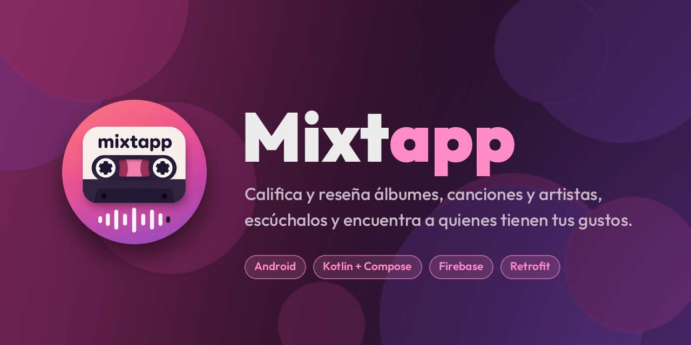
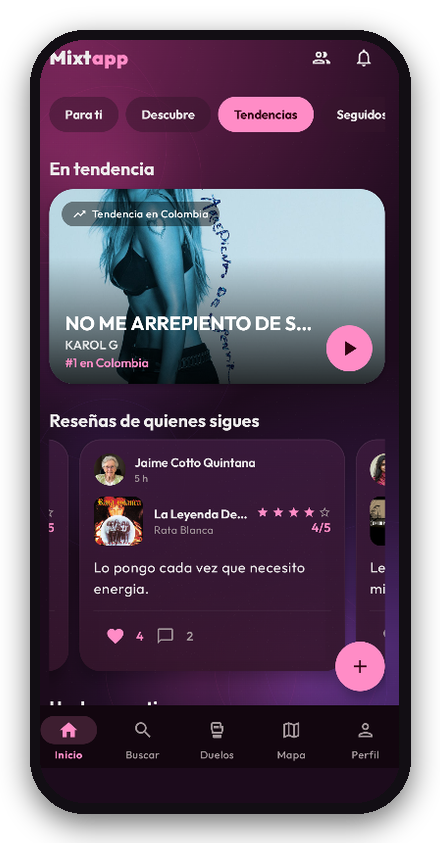
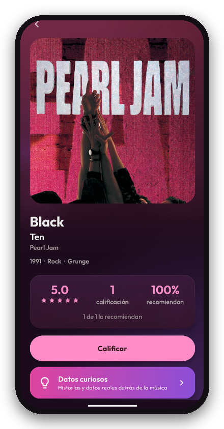
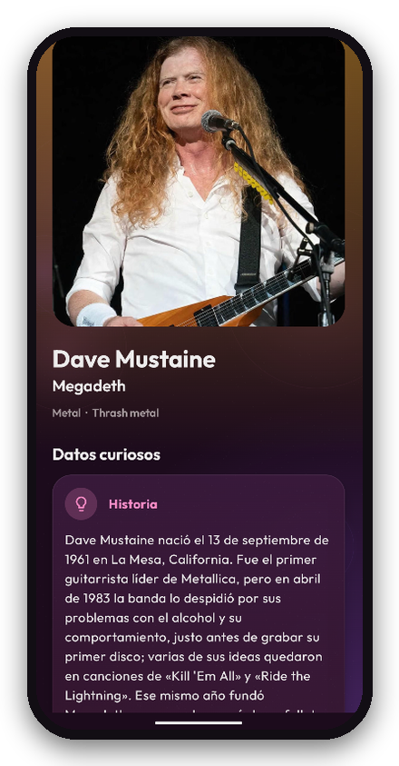
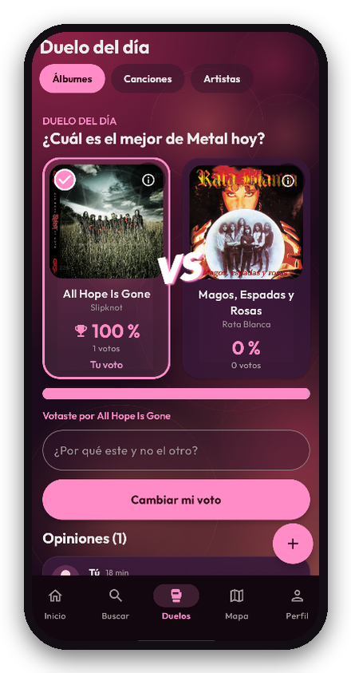
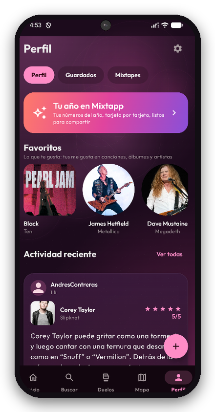
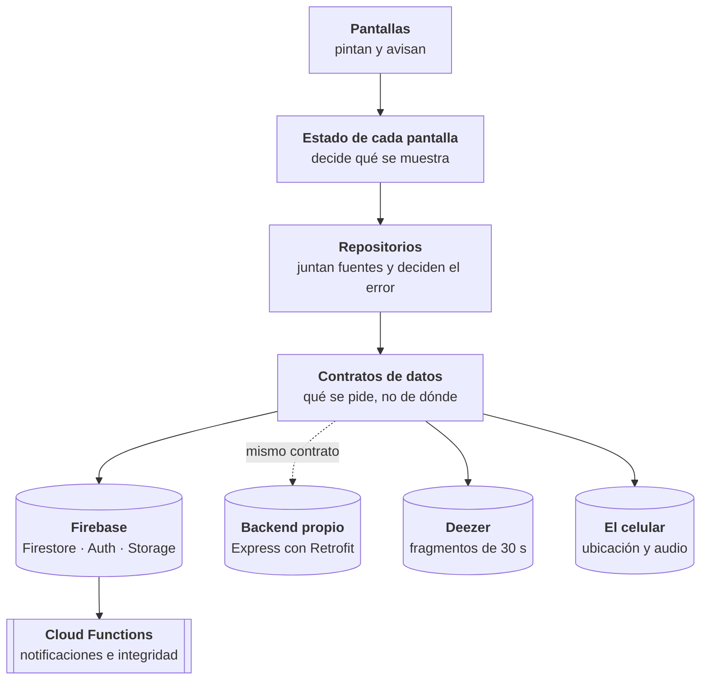

  

  
  
  
  
  
  

## Objetivo

La música se escucha en una app y se comenta en otra. No hay un lugar donde guardar lo que opinas
de un disco, ver qué piensa la gente que te importa y descubrir música por gustos reales, no por un
algoritmo que no explica nada.

**Mixtapp** junta todo eso en una sola app:

  
  
  

  
  

Inicio · Detalle de una canción · Datos curiosos · Duelo del día · Perfil

## Arquitectura

**Cómo se tomaron las decisiones:**

- **Cada capa tiene un solo trabajo.**
  - La pantalla no decide nada: pinta el estado y avisa lo que se tocó.
  - El estado vive fuera de la pantalla y sobrevive a los giros del celular.
  - Las reglas del negocio (la afinidad entre personas, quién puede votar, cómo se arma una playlist)
    viven en el modelo y se prueban sin el celular.
- **La base de datos se puede cambiar.**
  - Cada fuente de datos se define por un contrato con dos implementaciones: Cloud Firestore y el
    backend de Express por Retrofit.
  - Pasar de una a otra es una línea en la inyección de dependencias, sin tocar ninguna pantalla.
- **El repositorio decide el error.** La fuente solo trae el dato o avisa que no existe. El
  repositorio convierte cada fallo en un mensaje claro: sin internet, sin permiso, no encontrado.
- **Tiempo real de punta a punta.** Los listeners de Firestore viajan como flujos hasta la pantalla,
  así que nadie tiene que recargar.
- **Los datos no se descuadran.**
  - Los contadores (likes, votos, seguidores) se actualizan en transacciones.
  - Las escrituras que van juntas se guardan en lote.
  - Las Cloud Functions mantienen al día las copias: si alguien cambia su foto, cambia en todas sus
    reseñas.
- **Se cuidan las lecturas y el costo.**
  - Lo que no cambia mientras usas la app (el catálogo, los datos curiosos) se lee una vez.
  - Los medios no pasan por la base:
    - el fragmento se pide a Deezer al tocar play;
    - el video del inicio de sesión viene dentro de la app;
    - las animaciones de los artistas son enlaces públicos.
- **Dos entornos:** en desarrollo la app usa el emulador de Firebase con datos de prueba, y la
  versión final usa el Firebase real.
- **Un solo diseño:** una tipografía, una paleta y componentes compartidos entre pantallas. Así cada
  pantalla nueva sale coherente con las demás.

## Ecosistema

| Repositorio | Qué hace |
|---|---|
| **Mixtapp** (este) | La app Android |
| [mixtapp-functions](https://github.com/AndresContreras1/mixtapp-functions) | Cloud Functions de notificaciones e integridad, y el catálogo con los datos de prueba |
| [mixtapp-backend](https://github.com/AndresContreras1/mixtapp-backend) | API REST en Express, la segunda fuente de datos de la app |

## Calidad

- **244 pruebas unitarias** de los repositorios, los estados de las pantallas, las reglas y los
  mapeos, con dependencias simuladas.
- **Pruebas de integración** de las fuentes de datos y los repositorios contra el emulador de
  Firebase.
- **Pruebas de punta a punta** de los casos de uso principales: registrarse y dar me gusta, y seguir
  a otra persona.
- **Datos de prueba reproducibles:** un script carga el catálogo real y 20 usuarios con reseñas,
  likes y discusiones.

## Probarla

1. Clonar este repositorio y [mixtapp-functions](https://github.com/AndresContreras1/mixtapp-functions).
2. Prender el emulador de Firebase desde `mixtapp-functions`.
3. Cargar los datos de prueba con el script de `seed`.
4. Abrir este proyecto en Android Studio y correr la variante debug en un emulador de Android.

Los comandos completos, las pruebas y el APK firmado están en [Cómo ejecutarlo](Docs/ejecucion.md).

## Documentación

La arquitectura en detalle, el modelo de datos, las notificaciones, las decisiones y la historia del
proyecto por sprint están en **[Docs](Docs/README.md)**.
